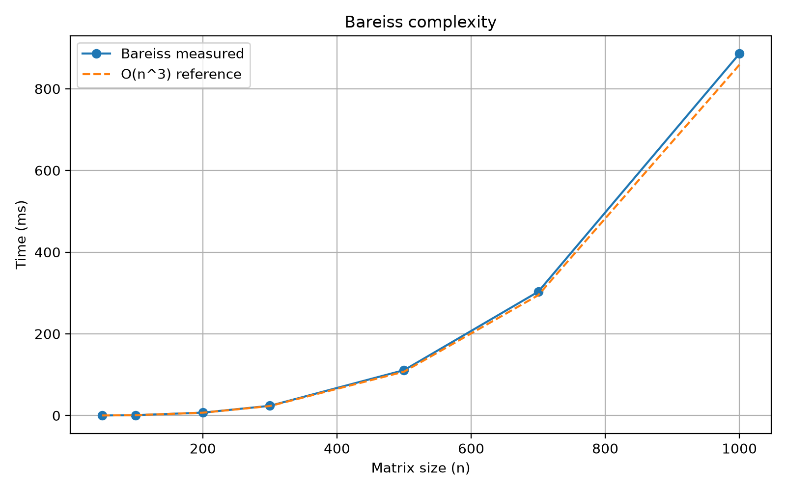

# HWMN

A C++17 matrix library focused on RAII, manual memory
management, copy/move semantics, and determinant computation.

## Features

- `Matrix<T>` — contiguous memory layout (`T*`).
- `JaggedMatrix<T>` — separately allocated rows (`T**`).
- Rule of Five and deep copying.
- Templated Gaussian elimination with partial pivoting.
- Templated Bareiss determinant algorithm.
- Automatic algorithm selection based on the element type.
- Unit tests and performance benchmarks.

## Architecture

```text
HWMN/
├── include/
│   ├── matrix/
│   │   ├── Matrix.hpp
│   │   └── JaggedMatrix.hpp
│   └── determinant/
│       ├── Gaussian.hpp
│       ├── Bareiss.hpp
│       └── Determinant.hpp
├── benchmarks/
│   ├── main.cpp
│   └── GenerateMatrices.hpp
├── tests/
│   ├── MatrixTests.cpp
│   ├── JaggedMatrixTests.cpp
│   ├── GaussianTests.cpp
│   ├── BareissTests.cpp
│   ├── DeterminantTests.cpp
│   ├── MatrixGeneratorTests.cpp
│   └── LargeMatrixTests.cpp
├── plot/
│   ├── plot.py
│   └── complexity.png
├── CMakeLists.txt
└── README.md
```

## Build

Requires C++17 and CMake.

GoogleTest and Google Benchmark are downloaded automatically
using CMake FetchContent.

```bash
mkdir build-release
cd build-release
cmake .. -DCMAKE_BUILD_TYPE=Release
make
```

## Testing

Tests are implemented using GoogleTest.

```bash
ctest
```

## Benchmarks

Performance measurements are implemented using Google Benchmark.

```bash
./HWMN \
    --benchmark_repetitions=5 \
    --benchmark_min_warmup_time=0.5 \
    --benchmark_out=results.json \
    --benchmark_out_format=json
```

Both algorithms are tested on identical dense structured matrices
of the form $A = I + uv^T$.

Matrix sizes: 50, 100, 200, 300, 500, 700, 1000.

Gaussian elimination uses `long double` arithmetic, while
the Bareiss algorithm uses `long long` arithmetic.

Structured input matrices are used to avoid integer overflow
for the selected matrix sizes.

Median CPU time is used for performance comparison.



## Results

- Both algorithms exhibit approximately cubic time complexity,
  $O(n^3)$.
- Contiguous and jagged memory layouts demonstrate similar
  performance.
- Bareiss is slightly faster than Gaussian elimination under
  the tested conditions.

The results depend on the selected numeric types, input matrices,
compiler optimizations, and hardware.

## Plotting

Requires Python and Matplotlib.

From the repository root:

```bash
cd plot
python plot.py
```