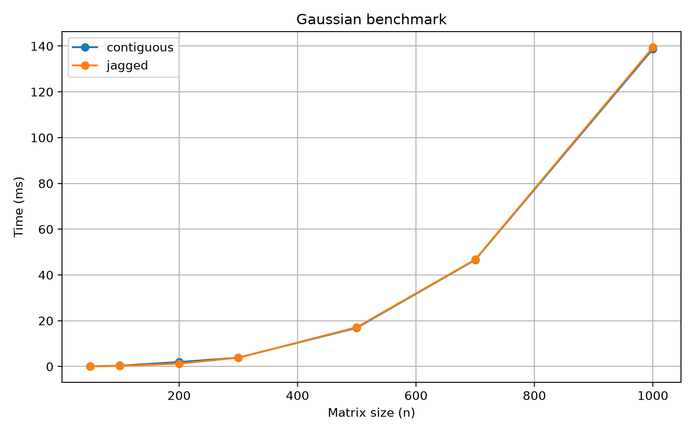
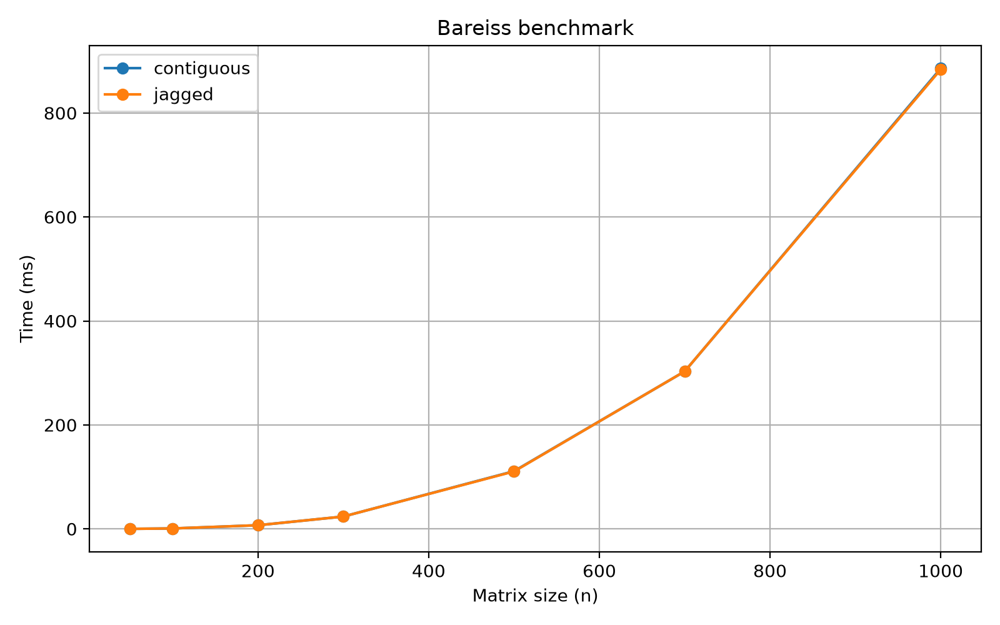

# HWMN

A C++17 implementation of matrix operations focused on RAII, manual memory management, copy/move semantics, and determinant computation.

## Features

- **Matrix** — contiguous memory layout (`T*`).
- **JaggedMatrix** — separately allocated rows (`T**`).
- Rule of Five and deep copying.
- Gaussian elimination with partial pivoting.
- Bareiss determinant algorithm.
- Unit tests, large-matrix tests, and performance benchmarks.

## Architecture

```text
HWMN/
├── include/
│   ├── matrix/
│   │   ├── Matrix.hpp
│   │   └── JaggedMatrix.hpp
│   └── determinant/
│       ├── Gaussian.hpp
│       ├── Bareiss.hpp
│       └── Determinant.hpp
├── src/
│   └── determinant/
│       ├── Gaussian.cpp
│       ├── Bareiss.cpp
│       └── Determinant.cpp
├── benchmarks/
│   ├── main.cpp
│   ├── Benchmark.hpp
│   └── GenerateMatrices.hpp
├── tests/
│   ├── MatrixTests.cpp
│   ├── JaggedMatrixTests.cpp
│   ├── GaussianTests.cpp
│   ├── BareissTests.cpp
│   ├── MatrixGeneratorTests.cpp
│   └── LargeMatrixTests.cpp
├── plot/
│   ├── plot.py
│   ├── gaussian.png
│   ├── bareiss.png
│   └── complexity.png
├── CMakeLists.txt
└── README.md
```

## Build

Requires C++17 and CMake.

```bash
mkdir build-release
cd build-release
cmake .. -DCMAKE_BUILD_TYPE=Release
make
```

## Run

```bash
./HWMN
```

Benchmark results are printed in CSV format.

## Testing

Tests are implemented using GoogleTest.

```bash
ctest --output-on-failure
```

## Benchmarks

Performance measurements compare Gaussian elimination and the Bareiss algorithm using contiguous and jagged matrix layouts.

Gaussian elimination is tested on random floating-point matrices, while Bareiss is tested on upper triangular integer matrices.

### Gaussian Elimination



### Bareiss Algorithm



### Computational Complexity


Both implementations exhibit approximately cubic time complexity. The measured performance differences between the two memory layouts are relatively small for the tested matrices.

The algorithms use different numeric types and input matrices, so their execution times are not directly comparable as general measures of algorithm efficiency.